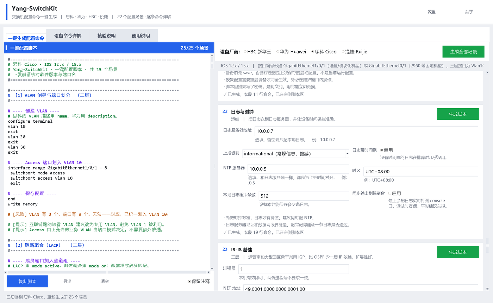
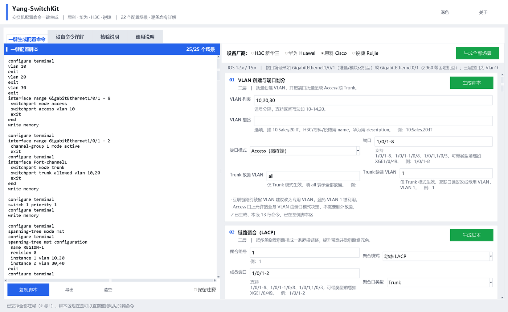
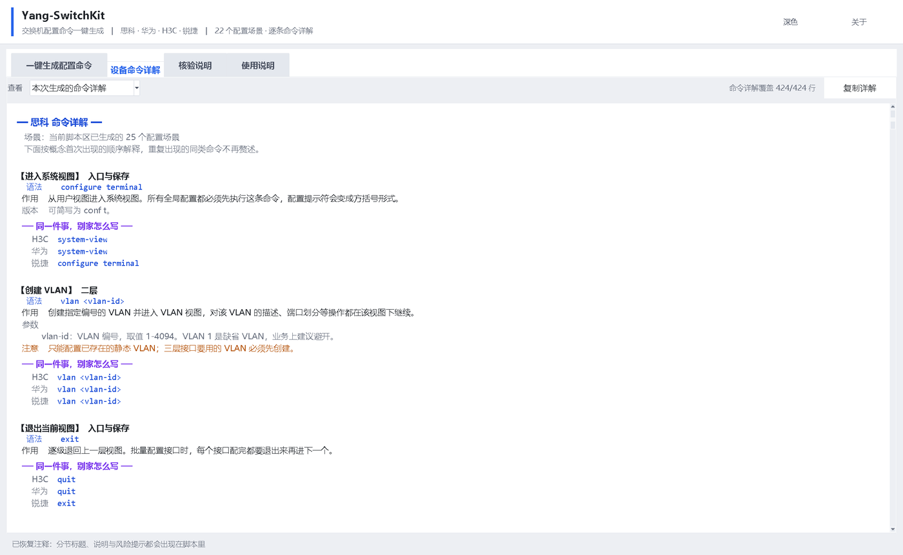

# Yang-SwitchKit · 交换机配置命令一键生成

一个离线的 Windows 桌面工具：选厂商、填参数，一键产出**可以直接粘贴到设备的交换机配置命令**，
同时给出**每条命令的详解**与**四厂商命令对照**。

覆盖 **思科 / 华为 / H3C / 锐捷** 四家，每家 **25 类高频场景**，共 **100 组**命令模板、
**1734 行**命令，配 **156 条**命令概念详解，详解覆盖率 **100%**。



| 取消「保留注释」→ 纯命令 | 设备命令详解 |
|---|---|
|  |  |

> 想了解代码怎么组织、模块之间怎么联动，看 **[docs/ARCHITECTURE.md](docs/ARCHITECTURE.md)**。

---

## 一、怎么用

1. 双击 `YangSwitchKit.exe`（首次启动约 2-3 秒，单文件程序需要自解压）
2. 在「一键生成配置命令」页右上角选设备厂商
3. 右侧是一页到底的参数区，**每个场景一张卡片**，各带一个绿色的「生成脚本」按钮。
   填好某个场景的参数后点它的「生成脚本」，这段命令就落到左边的脚本区；
   想一次全要，点最上面的「生成全部场景」
4. 左侧脚本区点「复制脚本」直接粘贴到设备，或点「导出」存成 .txt
5. 想搞清楚每条命令在干嘛，切到「设备命令详解」页

界面说明：

- 界面是**左侧脚本区 + 右侧参数区**的布局：参数全在一页上，不用来回切场景
- 顶栏的「深色 / 浅色」按钮可切换主题，默认**浅色**（白底卡片 + 浅灰窗口底）
- 每个厂商的参数**分开保存**，来回切换厂商不会把填好的值冲掉；
  已经生成过的场景，切换厂商后会自动按新厂商重算一遍
- 厂家选择条下面那行灰色小字是该厂商的**接口命名习惯**，填端口前先看一眼，
  别把 H3C 的 `1/0/1` 填给华为（华为从 `0/0/1` 开始）
- 脚本区里 `#` 开头的是注释（思科 / 锐捷是 `!`），设备不执行；
  **想去掉注释直接拿去用**，把左下角的「保留注释」勾去掉即可：
  分节标题、逐段说明、风险提示和 `!` 注释行会一起被清掉，
  只留命令本身，场景之间用空行隔开。这时候点「复制脚本」或「导出」，
  得到的就是一段可以直接整段粘到设备上的命令
- 卡片底部的状态行会告诉你这一段是否已生成、生成了多少行；
  参数有问题会直接红字写在这个位置，同时脚本区尾部也会列出「未生成」的场景
- 红色 `[风险]` 是风险项，青色 `[提示]` 是场景说明，粘贴前建议扫一眼

## 二、四个页面分别是什么

| 页面 | 作用 |
|------|------|
| 一键生成配置命令 | 左脚本区 + 右参数区，按场景分块生成 |
| 设备命令详解 | 三种视图：本次生成的命令详解 / 该厂商命令手册 / 四厂商命令对照 |
| 核验说明 | 这一版做了哪些核对、发现并改掉了哪些错误、哪些还需要你自己确认 |
| 使用说明 | 工具的定位、操作步骤、命令正确性说明与使用边界 |

「设备命令详解」的三种视图：

- **本次生成的命令详解** —— 把脚本区里已有的命令逐条讲清楚：语法原型、作用、参数含义、
  使用注意、版本差异，并附上「同一件事别家怎么写」。脚本区变了，这里跟着变
- **该厂商命令手册** —— 该厂商适用的全部命令概念，按二层 / 三层 / 安全 / 运维等分组
- **四厂商命令对照** —— 同一件事在四家分别怎么写，适合横向记忆

## 三、支持的场景（25 个）

| 分组 | 场景 | 说明 |
|------|------|------|
| 二层 | VLAN 创建与端口划分 | 批量建 VLAN，端口批量配 Access / Trunk |
| 二层 | 链路聚合（LACP） | 动态 LACP 与静态聚合 |
| 二层 | 生成树（MSTP / RSTP） | 模式、根桥角色、实例映射、边缘端口 |
| 二层 | 端口隔离（保护口） | 同 VLAN 内端口两两隔离，可连三层一起隔离 |
| 二层 | 环路检测与 BPDU 保护 | 兜底傻瓜交换机造成的环路 |
| 三层 | DHCP 服务与中继 | 本机做服务器，或中继给外部服务器 |
| 三层 | 静态路由 | 含浮动路由（优先级 / 管理距离） |
| 三层 | 组播 IGMP Snooping | 含查询器、静态路由器端口、快速离开 |
| 三层 | OSPF 基础 | Router ID、宣告网段、区域验证、被动接口 |
| 三层 | IS-IS 基础 | NET、设备层级、度量风格、接口邻接与验证 |
| 三层 | BGP 基础（EBGP / IBGP） | 邻居、地址族激活、宣告网段、MD5 验证 |
| 三层 | MPLS L3VPN（PE 侧） | LDP 建隧道、VPN 实例、MP-BGP 传 VPN 路由 |
| 高可用 | 堆叠 / IRF / VSU | H3C IRF、华为 iStack、思科 StackWise、锐捷 VSU |
| 高可用 | 网关冗余（VRRP / HSRP） | 虚拟网关，含上行链路联动 |
| 安全 | ACL 访问控制 | 基础 / 高级 ACL，定义规则并应用到接口 |
| 安全 | 端口安全与 MAC 绑定 | 限制 MAC 数量，MAC 固化绑定，防私接 |
| 安全 | 广播风暴抑制 | 广播 / 组播 / 未知单播分别设阈值 |
| 安全 | DHCP Snooping | 挡私接路由器发地址，建立绑定表 |
| 安全 | ARP 防护与 IP 源防护 | 动态 ARP 检测 + 禁止私改 IP |
| 运维 | 端口镜像 | 端口镜像与 VLAN 镜像 |
| 运维 | 管理面加固 | 账号、SSH、NTP、SNMP、管理地址 |
| 运维 | 端口限速（QoS） | 按端口限制上下行速率 |
| 运维 | 巡检与排障命令 | 七类查询命令，覆盖设备 / 接口 / 二层 / 三层 / 安全 / 硬件 / 日志 |
| 运维 | 配置备份与恢复 | TFTP / FTP 备份到服务器，或从服务器回滚 |
| 运维 | 日志与时钟 | syslog 服务器、时间戳、时区、NTP |

合计 **4 厂商 × 25 场景 = 100 组**，每组少则几行、多则几十行命令。

## 四、端口写法

支持简写，程序会按厂商展开成完整接口名：

| 写法 | 展开结果（H3C 为例） |
|------|---------------------|
| `1/0/1-8` | GigabitEthernet1/0/1 … GigabitEthernet1/0/8 |
| `1/0/1-1/0/8` | 同上 |
| `1/0/1,1/0/3` | 两个端口 |
| `XGE1/0/49` | Ten-GigabitEthernet1/0/49 |
| `Te1/0/49` | 同上（思科 / 锐捷按各自命名输出） |

端口连续时会自动合并成 `interface range` 写法，减少命令行数。

## 五、关于命令准确性

**这一点请务必读完。**

命令以四厂商官方命令手册为准逐条核对过，语法、关键字、参数顺序与命令所处的视图都做了比对，
并重点排查了「同一件事各家写法不同」的跨厂商陷阱。这一版修正的典型错误包括：

- **基础 / 标准 ACL 误带协议关键字**：ACL 2000（H3C / 华为）与 ACL 10（思科 / 锐捷）
  只能匹配源地址，规则里不允许出现 `ip` / `tcp` 协议字段，也不能写目的地址与端口。
  修正前生成的 `rule permit ip source ...` 下发时会直接报语法错误。
- **ACL 编号区间按厂商拆分**：思科 / 锐捷的 100-199 是扩展 ACL，与 H3C / 华为的
  2000-2999 基础 ACL 不在同一体系。修正前输入 100 会被当成标准 ACL，规则里的协议与端口被静默丢弃。
- **华为 VLAN 镜像命令**：修正前为 `mirror to observe-port`（少了 `-ing`，且方向取值超出主流版本支持范围），
  修正后为 `mirroring to observe-port <索引> inbound`。
- **锐捷 SSH 服务端未开启**：RGOS 默认关闭 SSH 服务端，修正前缺少 `enable service ssh-server`，SSH 一定连不上。
- **锐捷关闭 Telnet 的多余命令**：移除无对应含义的 `no service telnet`，只保留官方命令。

**但仍需你在设备上确认这些（工具无法替你保证）：**

- **端口名与槽位号**：生成的端口名必须与设备 `show interface` / `display interface brief` 的实际输出逐字一致
- **标注了「版本」「部分版本」的命令**：这类语法随软件版本变化，下发前用 `?` 补全确认
- **堆叠 / IRF / VSU**：随型号差异最大，本工具给出的是骨架，必须对照本机手册
- **地址与参数**：接口地址、虚拟网关、VLAN 编号由你填入，工具不校验是否与现网冲突
- **明文密码**：结果中的密码为明文，仅用于开局，交付前必须统一更换

建议流程：**先在模拟器或实验设备上跑一遍，确认无误再上生产。**

工具生成的是配置文本，**不会连接设备、不会自动下发**——最终执行由你决定。

### 新增场景的额外提醒

第二批加进来的 12 个场景（端口隔离、端口安全、风暴抑制、环路检测、DHCP Snooping、
ARP 防护、IGMP Snooping、OSPF、端口限速、巡检命令、配置备份、日志与时钟）里，
有几处**各家各版本写法差异较大**的地方，工具已经按最主流的写法生成并在结果里标注，
但下发前请务必用 `?` 补全确认：

- **华为风暴控制**：官方命令是 `storm control ... min-rate X max-rate Y`，
  但部分 VRP V5 版本（如早期 S5700）写作带连字符的 `storm-control`
- **华为环路检测动作**：主流写法是 `loop-detection mode port-shutdown`，
  部分 V200 版本的关键字集合不同
- **思科**：思科**没有**环路检测（发探测帧）这个功能，工具生成的是
  PortFast + BPDU 保护 + errdisable 自动恢复这套替代方案
- **锐捷**：环路检测是全局开关，不能按端口单独开关；
  IP 源防护的命令随 RGOS 版本变化，工具没有生成，只给了提示
- **静态 IP+MAC 绑定**：这条命令四家的写法差异最大，工具**不生成**，
  只在结果里给出各家命令模板作为注释
- **巡检命令**：个别 `show` / `display` 命令随版本不同（聚合口状态、光模块信息等）

## 六、目录结构

```
Yang-SwitchKit/
├── main.py                  启动入口
├── build.py                 打包脚本（生成 dist/YangSwitchKit.exe）
├── docs/
│   ├── ARCHITECTURE.md      架构说明：逐模块详解 + 模块间联动
│   └── images/              README 与文档用的配图
├── scg/                     核心包
│   ├── model.py             数据结构：参数、场景、生成结果
│   ├── ports.py             端口写法解析与展开
│   ├── registry.py          场景注册表（25 个场景的参数定义）
│   ├── explain.py           命令详解知识库（156 条概念 + 四厂商写法）
│   ├── verify.py            命令正确性核验记录
│   ├── vendors/
│   │   ├── base.py          结果构建器 + 各厂商共用的解析工具
│   │   ├── h3c.py           四家命令库
│   │   ├── huawei.py
│   │   ├── cisco.py
│   │   └── ruijie.py
│   └── ui/
│       ├── window.py        主窗口
│       ├── theme.py         配色与 ttk 主题
│       └── dpi.py           高 DPI 适配
└── tools/
    ├── smoke_test.py        4 × 25 全组合冒烟测试
    ├── make_icon.py         生成 ico
    ├── verify_exe.py        验证打包产物能否正常启动
    ├── wincap.py            抓取窗口自身画面（避免拍到其它窗口）
    └── shot.py              界面截图（开发用）
```

**每个模块具体负责什么、以及模块之间怎么联动，见 [docs/ARCHITECTURE.md](docs/ARCHITECTURE.md)。**

## 七、二次开发

**加一个场景：** 在 `scg/registry.py` 里加一条 `Scenario`，再到四个 `vendors/*.py` 的
`_HANDLERS` 里注册对应函数即可。界面表单是从参数定义自动生成的，不用改 UI。

**改命令：** 只动对应厂商文件里的函数，互不影响。

**加命令详解：** 在 `scg/explain.py` 的 `CATALOG` 里加一条 `D(...)`，把各厂商的
正则与语法原型写进 `forms`。工具会在自检时报告未覆盖的命令行。

**验证：** 改完先跑一遍全组合测试：

```
python tools/smoke_test.py
```

看某个场景的具体输出：

```
python tools/smoke_test.py --show h3c/stacking
```

**重新打包：**

```
python build.py
```

## 八、运行环境

- 源码运行：Python 3.12（需要 Tkinter，Windows 官方安装包自带）
- 打包运行：Windows 10 / 11，无需安装 Python
- 已适配高 DPI 缩放（125% / 150% 下不会发虚）
