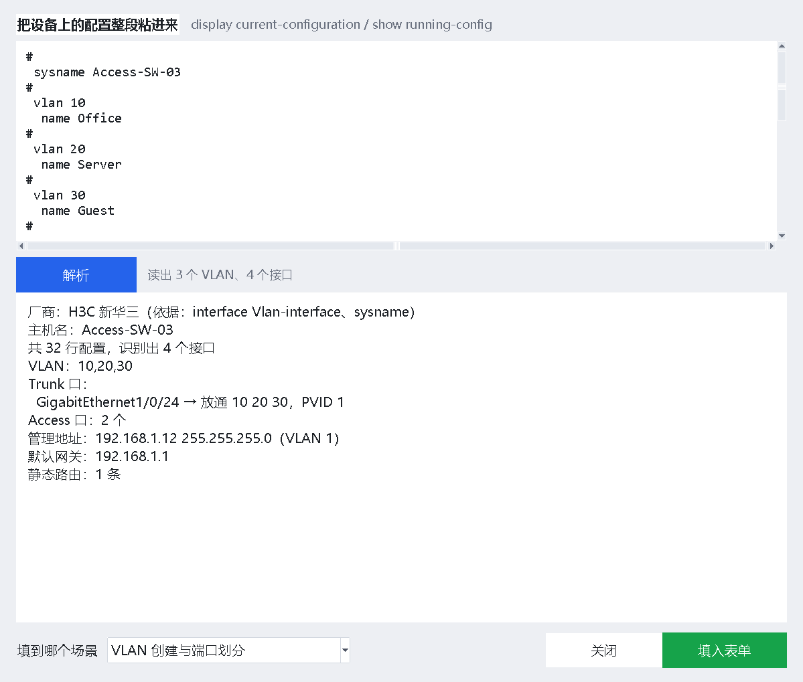
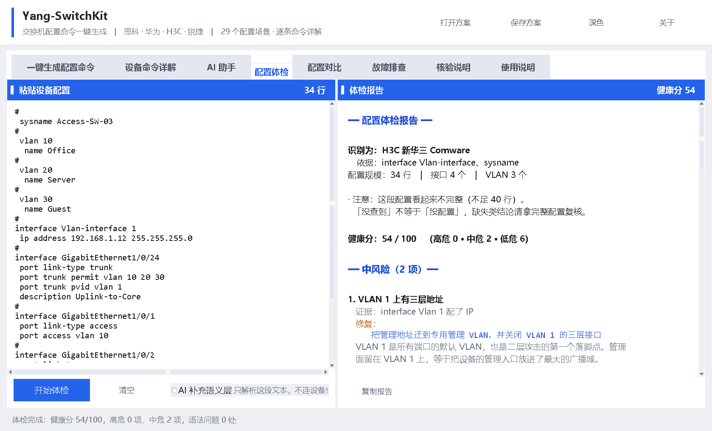
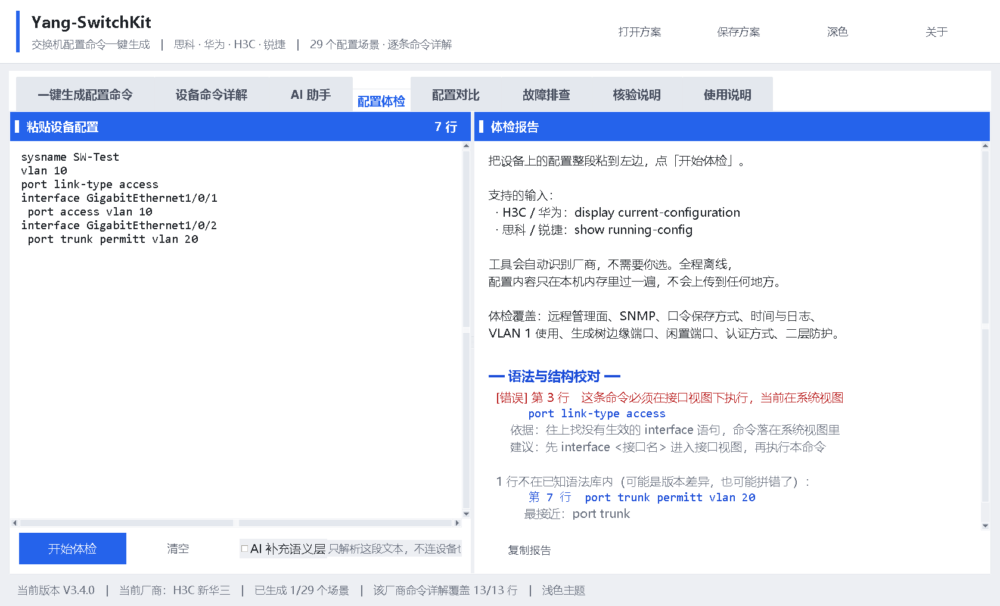
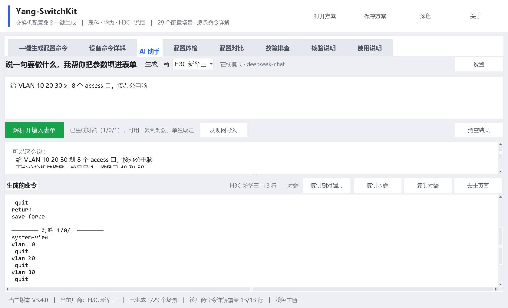

# 配交换机时最烦的那几步，我这次做进工具里了

上周去一个客户那儿加个 VLAN 40。

先在设备上 display vlan 看现在有哪些，10、20、30。再 display port vlan 找上联口，是 GigabitEthernet1/0/24，PVID 1。拿手机拍了张屏，回工位打开工具，一条一条往表单里填。

填完核对的时候发现，VLAN 列表我写成 10,20,3，少了个 0。

这种错不新鲜。抄四五个值，中间接个电话，回来就不知道抄到哪了。工具本身没问题，问题是我得先当一次人肉搬运工。

所以这次更新主要就是冲着这几步去的。

---

## 一、粘一段配置，它自己读出现状

AI 助手页新加了个「从现网导入」按钮。

把设备上 display current-configuration 的输出整段粘进去，点解析：



它读出来这些东西：

- 厂商（按特征串判，H3C 是 interface Vlan-interface 和 sysname）
- VLAN 列表：10、20、30
- Trunk 口：GigabitEthernet1/0/24，放通 10 20 30，PVID 1
- Access 口几个
- 管理地址、网关、静态路由

然后选个场景，点「填入表单」，能对上的字段直接带进去。

这一层是纯本地解析，**不需要联网也不需要密钥**。整个流程就是正则加一个状态机，几十毫秒跑完。

四家的写法都认。H3C 的 port trunk permit vlan 10 20 30 是空格分隔，思科的 switchport trunk allowed vlan 10,20,30 是逗号，华为叫 allow-pass，这些差异都在解析器里处理掉了。

有两条原则我是写死在代码里的，这里说清楚：

**读不到的字段就留空，不填默认值。** 表单里的值最后会变成要下发的命令，我猜一个塞进去，你在设备上就多了一条错命令。宁可让你多填一个框。

**只覆盖能从现状反推的场景。** 现在支持 VLAN 划分、管理面、静态路由、端口隔离这四类。像 BGP、MPLS、堆叠，现状里压根没有能直接当参数用的字段，会明确告诉你「这个场景没有可导入的字段」，不会硬凑。

---

## 二、说一句话，它把参数填好

同一页上面那块是给 AI 用的。

输入「给 VLAN 10 20 30 划 8 个 access 口，接办公电脑」，它识别出场景、抽出参数、回填到表单、生成命令。顶栏有个厂商下拉，选哪家就按哪家的语法抽参数，因为端口编号习惯不一样（H3C 从 1/0/1 起，华为从 0/0/1 起）。

这块有个前提得说明：**模型只负责填参数，命令永远是本地模板拼的。**

它输出的是 {"vlans": "10,20,30", "port_type": "access", "ports": "1/0/1-8"} 这种字段值，不是命令文本。参数是有限、可枚举、能校验的；命令不是。让模型直接写命令，看着快，但它在端口号上编一个数你未必看得出来。

所以这个功能做得比「接个大模型」麻烦得多，值不值由你用的时候判断。

不配密钥就是纯离线，其它所有功能一点不受影响。

---

## 三、配置体检，现在分三层

原来只有一层：安全检查。粘配置进去，出健康分和风险清单。



这次加了两层。

中间那层是语法与结构校对，纯离线：



图里两个例子，一是 port link-type access 写在系统视图里（这类命令必须在接口视图下执行），二是 port trunk permitt vlan 20 拼错了，它会给一个最接近的正确写法。

这层查的是「能不能跑」：命令跑没跑在对的视图、基础 ACL 是不是带了协议字段、华为 VLAN 镜像有没有漏 ing、锐捷配了 SSH 却没敲 enable service ssh-server、端口编号符不符合厂商惯例。

最上面那层是 AI 语义补充，默认不勾。勾了才会把脱敏过的配置发出去，补的是「配置互相冲突」「缺配套命令」「策略顺序错了」这类需要读懂整段配置才能发现的问题，不勾就一个字节都不出本机。

三层的分工其实很清楚：第一层看安不安全，第二层看能不能跑，第三层看合不合理。

---

## 四、配完不是结束，还得知道怎么验

以前工具到「生成命令」就结束了。但现场真正的风险点在下发之后：命令进去了，display 一看没生效，或者生效了但不是你以为的那个效果。

配错了能立刻看出来，**配了没生效反而容易被当成成功**。半个月后业务不通才发现，那时候没人记得当时动了什么。

所以每个场景现在都配了一组验收命令，29 个场景 4 家厂商都覆盖。VLAN 那个场景是这样：

```
1. VLAN 是否建好
   display vlan
   → 应能看到目标 VLAN，状态为 active

2. 端口 VLAN 归属
   display port vlan
   → 重点核对 1/0/1、1/0/2 … 共 4 个，PVID 应为预期值

3. 接口是否 up
   display interface brief
   → 目标端口状态应为 UP，协议状态 UP
```

命令故意不带具体参数。display port vlan GigabitEthernet1/0/24 是更精确，但端口名一旦和实际不一致就白敲一条不存在的接口。给一屏完整状态，后面跟一句「重点核对哪几个口」，多看一眼但不会敲错。

---

## 五、变更包：一次导出五段

写变更单的时候要五样东西：变更前什么样、命令、回滚、怎么验收、影响了谁。

以前得在四个页签里挨个点一遍，再手工拼到一个文档里。现在脚本区底下有个「变更包」按钮，一次导出：

```
==================================
Yang-SwitchKit 变更包
厂商：H3C 新华三
场景：1 个
生成时间：2026-11-27 11:59
==================================

━━ 二、配置命令 ━━
【1】VLAN 创建与端口划分　（二层）
system-view
vlan 40
 quit
interface range GigabitEthernet1/0/1 to GigabitEthernet1/0/4
 port link-type access
 port access vlan 40
 quit
return
save force

━━ 三、回滚命令 ━━
system-view
interface range GigabitEthernet1/0/1 to GigabitEthernet1/0/4
 undo port access vlan
 undo port link-type
quit
undo vlan 40
return
save force

━━ 四、验收清单 ━━
...

━━ 五、影响范围 ━━
VLAN 创建与端口划分　VLAN：40
VLAN 创建与端口划分　端口：1/0/1-4
```

回滚那段是反推出来的，按配置的逆序排，后配的先撤。导出的时候会自动跟一句提醒：撤销后回到的是默认值，不一定等于变更前的原状态，要精确恢复得载入变更前配置。

第一段「变更前状态」只有用过「从现网导入」才有内容。这两个功能在这儿接上了。

---

## 六、两端互联，不用配两遍

trunk 对接、链路聚合这种，本来是两台设备各配一遍。以前只能把参数重填一次，重填就是漏改的起点——放通列表少写一个 VLAN，或者 PVID 一边 1 一边 99。

现在本端配完，点命令区的「复制到对端…」，只填一个框：对端用哪个口。



剩下全部照搬，包括放通列表和 PVID。我特意只留了这一个输入框，不给分别改的入口。两端不一致最常见的错法就是「一端改了另一端忘了」，给了入口等于亲手留这个口子。

两段并列显示，各有一个复制按钮，分别取走。

这块有个边界得说清楚：**VRRP 和静态路由不适用**。静态路由是「A 指向 B 的地址、B 指向 A 的地址」，VRRP 是「虚拟 IP 相同、物理 IP 和优先级一主一备」，两端参数本来就不一样，复制出来的对端命令不能直接用。工具不替你猜这层关系，猜错了比不给更危险。

---

## 最后

这次动的地方都在两头：前面接「看现网」，后面接「验收」和「交付物」。生成命令那部分没动。

工具还是那个单文件 exe，十二三兆，Windows 双击就跑，不装运行时也不写注册表。断网能用，除了 AI 那两处要自己配 key。

小阳的赛博日记
